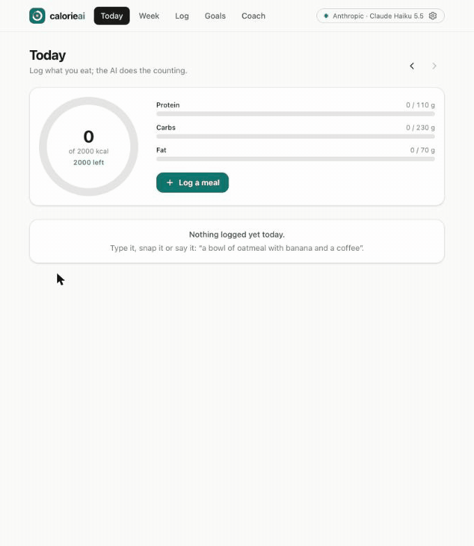

# calorie-ai-tracker

An AI calorie tracker that runs in your browser. Describe a meal, snap a photo of your plate or
just say what you ate, and a model of your choice works out the foods, portions, calories and
macros. Check the estimate, fix it by hand or in plain words ("it was a double portion"), and it
is logged. Follow each day against your goals and the whole week on a chart, let the AI set your
daily targets from your profile, and ask a coach that knows what you ate this week. No account,
no server: your meals stay in your browser.

**→ [maxgfr.github.io/calorie-ai-tracker](https://maxgfr.github.io/calorie-ai-tracker/)**



A meal described in words, estimated, then corrected ("it was 3 eggs, not 2"), the day and the
week, and the coach. Recorded on the live site with Claude Haiku 5.5, answers in French. Also as a
[video](https://maxgfr.github.io/calorie-ai-tracker/demo.mp4).

## How it works

1. **Connect a model.** Bring your own key through
   [llm-connect](https://github.com/maxgfr/llm-models/tree/main/packages/llm-connect): OpenAI,
   Anthropic, Google, Mistral and every OpenAI-compatible provider of the
   [llm-models](https://github.com/maxgfr/llm-models) catalog, or a local server (Ollama, LM
   Studio, Jan). Calls go straight from the browser to the provider.
2. **Log a meal**, three ways:
   - **Describe** it: "2 scrambled eggs, a slice of buttered sourdough and a latte".
   - **Photo**: the picture goes to your model (a vision model), which judges portions against
     the plate. It is only resized first, so the upload stays small. Text-only models are
     refused before any request.
   - **Voice**: the recording goes to your provider too, never processed on the device. A model
     that hears audio (Gemini, directly or through OpenRouter) gets it as is, in one call that
     returns the meal and what you said. Otherwise the provider's transcription model (OpenAI,
     Mistral's Voxtral, Groq) writes it down, and the text goes to your model. Anthropic takes no
     audio: pick another model for voice, or type.

   The model answers structured JSON, checked with Zod: each food with its portion, kcal,
   protein, carbs and fat, the meal type, a confidence level and its assumptions. You edit any
   row, or ask the AI to correct the estimate.
3. **Today**: a calorie ring against your goal, macro bars, the meals by type. Browse past days
   and log for any of them.
4. **Week**: calories per day against the goal line, daily average, days on target (±10%), days
   logged, logging streak. Go back week by week.
5. **Goals**: your profile (sex, age, height, weight, activity, objective, free notes) gives a
   Mifflin–St Jeor baseline; the AI adjusts it to your notes and your week, within safe bounds,
   and explains its numbers. Every number stays editable.
6. **Coach**: a streamed chat grounded in your goals, your week day by day and every meal logged
   this week, in the language you pick.
7. **Sync with GitHub** (optional): your data as one JSON file in a repository of yours, so every
   device you use has it. Create a private repository and a
   [fine-grained token](https://github.com/settings/personal-access-tokens/new) limited to it
   with Contents: read and write, then enter both in Settings. The app syncs on start, a moment
   after each change and when you come back to it. Each device merges before it writes: meals
   and messages are joined, the latest edit of a meal wins, a deleted meal stays deleted, the
   latest profile and goals win.

## Privacy

- Meals, photos (as small thumbnails), profile, goals and the coach conversation live in
  IndexedDB, in your browser. One button deletes them all from this device.
- The API key is encrypted at rest under a non-extractable WebCrypto key (llm-connect's
  `secureStorage`), and kept for the tab only unless you choose to remember it. The GitHub token
  is encrypted the same way.
- The only things sent anywhere are your meal descriptions, photos, recordings and coach
  questions, to the AI provider you chose, and, when you turn sync on, your data to your GitHub
  repository. Nothing is analysed on the device.
- The page's Content-Security-Policy allows no inline script and no third-party script. It can
  connect only to `https:` APIs (your provider, the model catalog) and to local model servers.

Estimates are approximate and this is not medical advice.

## Develop

```bash
bun install
bun run dev        # http://localhost:5173/, rebuilt on change
bun run test       # unit tests: stats, dates, energy, AI calls against a mocked model
bun run test:e2e   # Playwright: build, then log meals by text and voice against mocked providers
bun run typecheck
bun run lint
bun run build      # dist/, relative paths, ready for any static host
bun run catalog    # refresh public/models.json, the offline model catalog
```

Stack: Bun, Vite, React 19, TypeScript, Tailwind CSS 4,
[llm-connect](https://www.npmjs.com/package/llm-connect),
[llm-models](https://www.npmjs.com/package/llm-models), the AI SDK, Zod, idb.
MIT license.
